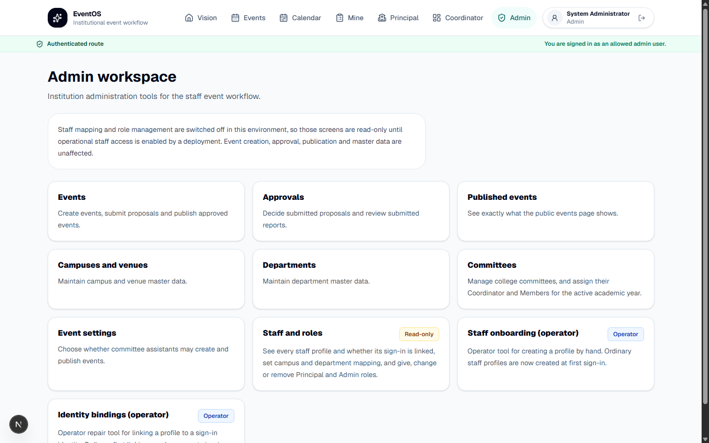

# Administrator Guide for JyotOS


**Quick Facts**
* **Audience:** System Administrators, College IT Cell, Platform Administrators
* **Applies To:** JyotOS Ecosystem (Platform & Application Administration)
* **Scope:** Identity management, access control, system configuration, and operational oversight


This guide summarizes system administration, access configuration, and operational management workflows across the live applications of the JyotOS ecosystem.

---

## 1. JyotOS Central (Identity & Access Hub)

JyotOS Central functions as the core control plane for institutional applications and access governance:

* **Application Catalog:** Register and maintain application tiles, environment URLs, and display metadata.
* **Access Provisioning:** Grant application access directly to individual staff accounts or configure group audience rules.
* **Access Request Queue:** Review, approve, or reject self-service access requests submitted by staff members.
* **Platform Roles:** Configure Central platform roles and assign administrative permissions.
* **Audit Log:** Review the chronological record of administrative actions, role assignments, and catalog changes.

→ See [Central Administrator Guide](../products/central/administrator-guide.md).

---

## 2. StaffBridge (Onboarding & Identity Administration)

StaffBridge manages the institutional staff identity lifecycle and profile verification:

* **Admin Verification:** Perform the final verification step for coordinator-reviewed profiles to establish Ready status.
* **Staff ID Assignment:** Generate and verify official staff identification numbers and digital identity credentials.
* **Department & Campus Mapping:** Configure campus locations (Amroli Campus, Chaprabhatha Campus) and department structures.
* **Profile Corrections:** Flag discrepancies and request corrections from staff members when documentation requires revision.

→ See [StaffBridge Administrator Guide](../products/staffbridge/administrator-guide.md).

---

## 3. EventOS (Event Management Administration)

*EventOS administrator dashboard for campus venue configuration, department setup, and event oversight.*

EventOS provides institutional event administration and venue configuration:

* **Campus & Venue Setup:** Define physical venues, room capacities, and facilities across Amroli and Chaprabhatha campuses.
* **Department & Category Configuration:** Manage department rosters and event classification taxonomies.
* **Event Oversight:** Supervise all submitted proposals, approved events, and published listings.


**Coming soon:** Platform-wide QR attendance scanning controls, participant export tools, and automated report aggregation are not available yet.


→ See [EventOS Administrator Guide](../products/eventos/administrator-guide.md).

---

## 4. ClassPulse Pro (Academic Master Data & Delivery)

ClassPulse Pro enables administrator configuration of academic terms and curriculum delivery:

* **Academic Master Data:** Maintain terms, semesters, classroom divisions, and course allocations.
* **Faculty Load Allocation:** Configure weekly contracted lecture quotas across full-time and visiting faculty.
* **Reconciliation Oversight:** Access the Faculty Lecture Reconciler across all departments to verify conducted lectures against assigned timetables.


**Coming soon:** Single sign-on with JyotOS via StaffBridge launcher is not switched on yet for ClassPulse Pro. Administrators access pilot settings using assigned credentials.


→ See [ClassPulse Pro Overview](../products/classpulse-pro/overview.md) and [Faculty Lecture Reconciler](../products/classpulse-pro/faculty-lecture-reconciler.md).
