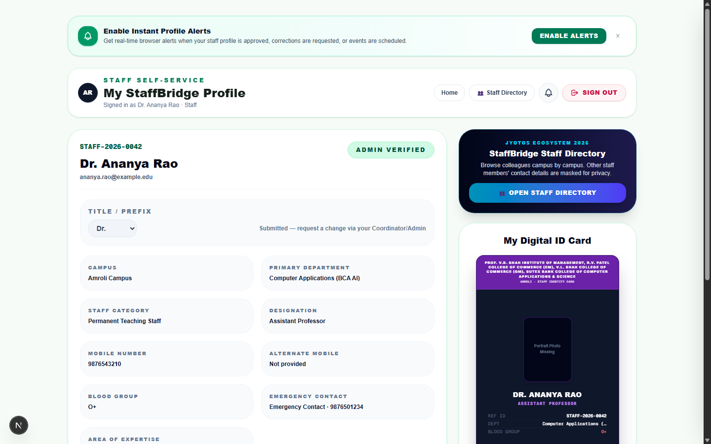

# Staff Guide for JyotOS


**Quick Facts**
* **Audience:** All institutional faculty and staff members
* **Applies To:** JyotOS Ecosystem (Self-Service Journey)
* **Access Requirement:** Official college Google account (`@amrolicollege.ac.in`)


This guide summarizes everyday self-service tasks for faculty and staff members across the live applications of the JyotOS ecosystem.

---

## 1. JyotOS Central (App Launcher)

**JyotOS Central** is your starting page for accessing institutional tools:

* **Sign in Once:** Use your official college Google account ending in `@amrolicollege.ac.in`. No separate passwords are required for connected applications.
* **Launch Applications:** Click on active application tiles to open your authorized tools.
* **Request Access:** If an application shows a lock icon, click **Request Access** to submit a self-service request to the administrator.
* **Theme Preference:** Choose between Auto (system), Light, or Dark mode from the user menu.

→ See [Central Staff Guide](../products/central/staff-guide.md).

---

## 2. StaffBridge (Identity & Onboarding)

*StaffBridge self-service profile dashboard showing verified credentials and digital ID card preview.*

**StaffBridge** establishes and maintains your verified institutional staff profile:

* **Complete Onboarding:** Enter personal information, employment classification, academic qualifications, and campus assignment.
* **Upload Media:** Submit your official photo and digital signature following clear guidelines.
* **Track Profile Status:** Monitor your profile progression through Submitted, Coordinator Verified, and Admin Verified stages.
* **Respond to Corrections:** If a reviewer flags an item, update the requested fields directly from your dashboard.
* **Digital ID Preview:** View your digital staff ID card with your unique staff reference number.

→ See [StaffBridge Overview](../products/staffbridge/overview.md) and [Using Your Staff Dashboard](../products/staffbridge/using-your-dashboard.md).

---

## 3. EventOS (Campus Events)

**EventOS** enables participation in college workshops, seminars, and academic programs:

* **Browse Events:** Explore upcoming and ongoing events organized across Amroli Campus and Chaprabhatha Campus.
* **Register:** Enroll in eligible events with a single click while registration windows remain open.
* **Cancel Registration:** Self-service cancellation is available if your schedule changes before registration closes.


**Coming soon:** Attendance verification by digital QR pass is not available yet.


→ See [EventOS Staff Guide](../products/eventos/staff-guide.md).

---

## 4. ClassPulse Pro (Teaching Portal)

**ClassPulse Pro** provides instructors with personal timetable and syllabus tracking:

* **Review Teaching Commitments:** View your contracted weekly teaching load and expected lecture hours.
* **Interactive Teacher's Diary:** Review your chronological register of conducted sessions, classroom divisions, and topics covered.
* **Print Diary:** Generate a formatted printout or PDF of your teaching diary for departmental reviews.


**Coming soon:** Single sign-on with JyotOS via StaffBridge launcher is not switched on yet for ClassPulse Pro. Pilot staff sign in using their assigned password.


→ See [My Teaching Portal](../products/classpulse-pro/teaching-portal.md).
