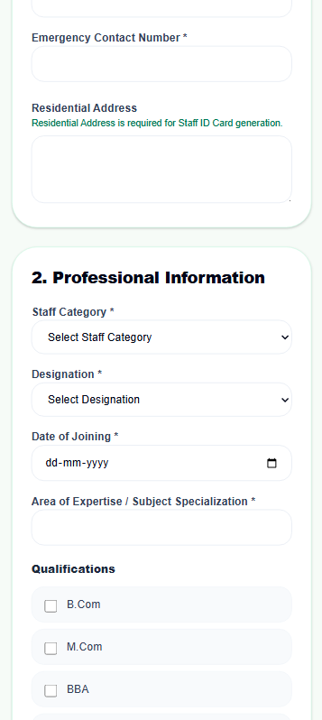
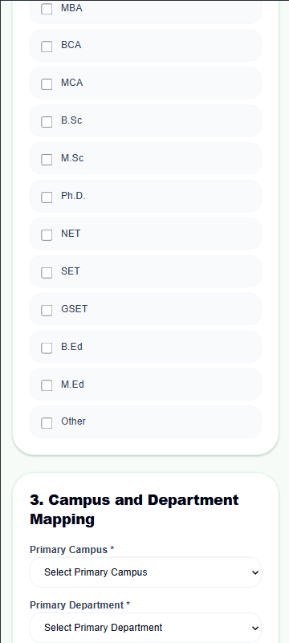
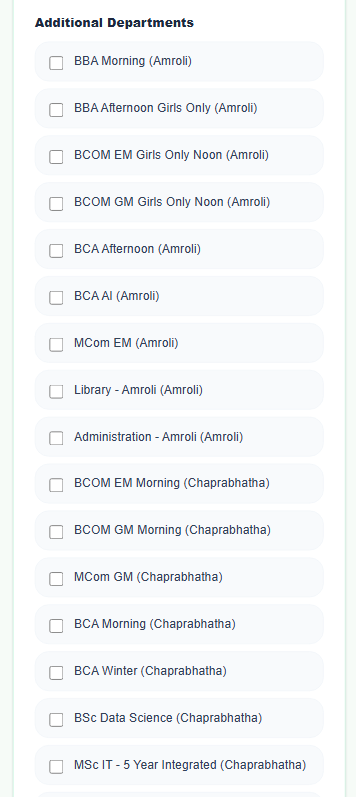

# Personal & Employment Information


**Guide Quick Facts**

* **Estimated Reading Time:** 4 minutes
* **Target Audience:** All Staff Members
* **Applies To:** StaffBridge Profile Data
* **Last Updated:** 06 August 2026 | **Version:** Internal Preview v0.3


This reference guide explains each personal, contact, professional, and department field collected in StaffBridge.

***

## 1. Personal & Contact Information Fields

* **Full Name:** Enter your full legal name formatted in Proper Case (e.g. `Dr. Hiral A. Patel`).
* **Official Email:** Must end strictly with `@amrolicollege.ac.in`.
* **Mobile Number:** 10-digit primary mobile contact.
* **Residential Address:** Complete residential address including 6-digit pincode.

***

## 2. Professional Information Fields

* **Staff Category:** Select Teaching, Non-Teaching, Administrative, or Support.
* **Official Designation:** Select your official appointment title (e.g. Assistant Professor, Accountant, Lab Assistant).
* **Date of Joining:** Official appointment start date.
* **Qualifications:** Check all earned academic degrees and certifications (B.A., M.A., Ph.D., NET, GSET).

***

## 3. Campus & Department Mapping

* **Primary Campus:** Select **Amroli Campus** or **Chaprabhatha Campus**.
* **Primary Department:** Main academic department or administrative unit.
* **Additional Departments:** Select additional departments for joint or cross-departmental duties.

***

**Version:** Internal Preview v0.3 | **Last Updated:** 06 August 2026 | **Applies To:** StaffBridge\
**Previous Step:** ← Complete Your Staff Onboarding | **Next Step:** Photo & Signature Guidelines →\
**Related Guides:** Complete Your Staff Onboarding · Photo & Signature Guidelines
