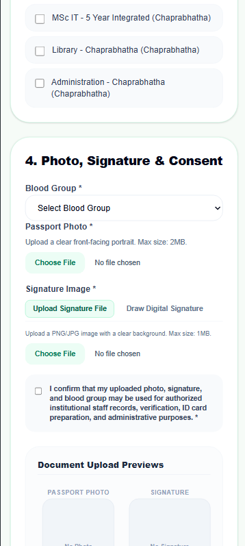

# Photo & Signature Guidelines


**Guide Quick Facts**

* **Estimated Reading Time:** 4 minutes
* **Target Audience:** All Staff Members
* **Applies To:** StaffBridge Identification Media
* **Last Updated:** 06 August 2026 | **Version:** Internal Preview v0.3


This guide details quality standards, upload instructions, and privacy rules for identification media.

***

## Identification Media Section

***

## Passport Photo Requirements

* **Format & Size:** JPEG or PNG image under 2 MB.
* **Visual Quality:** Clear, front-facing portrait with eyes visible, taken against a light plain background.

***

## Signature Image Requirements

* **Format Options:** Upload a scanned PNG/JPEG image (under 1 MB) or draw your signature directly on the digital canvas.
* **Drawing Canvas:** Use your finger or stylus on mobile screens, or mouse on desktop, to draw clearly inside the white box. Tap **Clear Canvas** to retry.

***

**Version:** Internal Preview v0.3 | **Last Updated:** 06 August 2026 | **Applies To:** StaffBridge\
**Previous Step:** ← Personal & Employment Information | **Next Step:** Understanding Your Profile Status →\
**Related Guides:** Complete Your Staff Onboarding · Troubleshoot Photo & Signature
