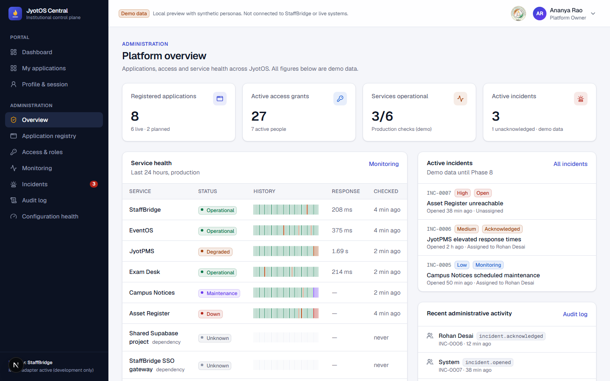
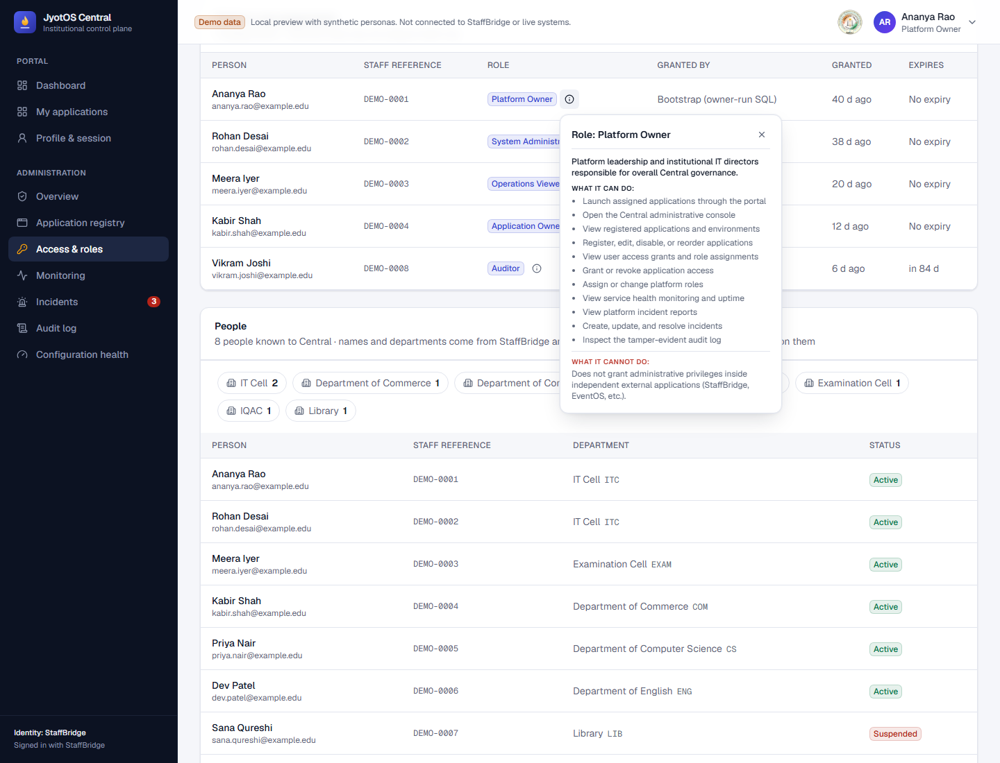
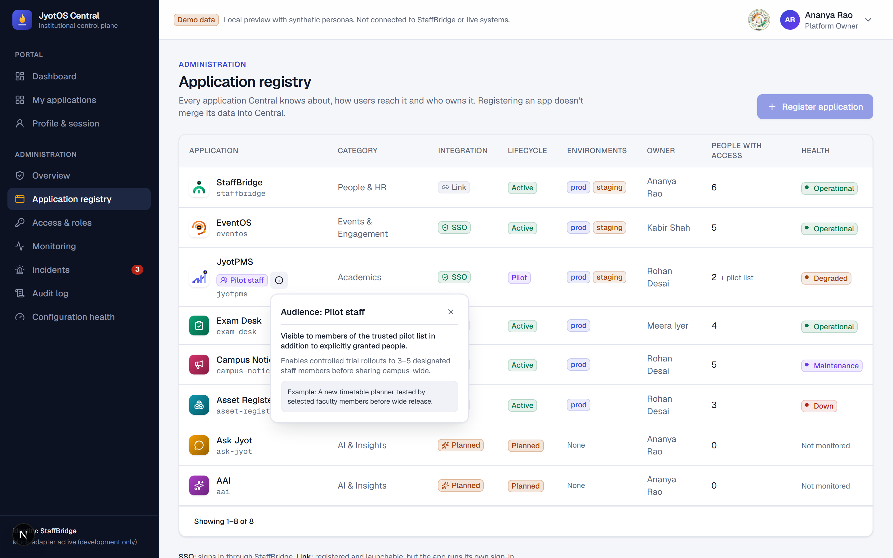

# JyotOS Central Administrator Guide


**Guide Quick Facts**

* **Estimated Reading Time:** 6 minutes
* **Target Audience:** Platform Owners, System Administrators, Application Owners, and Auditors
* **Applies To:** JyotOS Central Administration Console
* **Last Updated:** 24 November 2026


The **JyotOS Central Administration Console** provides institutional leadership and technical administrators with governance tools to manage applications, audience visibility rules, individual user access grants, and audit records.

*JyotOS Central administration console showing administrative hubs and statistics.*

***

## Platform Roles

Central defines six platform roles with strictly separated capabilities:

| Platform Role | Intended For | Key Capabilities | Boundaries & Restrictions |
|---|---|---|---|
| **Platform Owner** | Platform leadership and institutional IT directors | Full governance over applications, audiences, user grants, and assigning platform roles. | Does not grant administrative rights inside external applications (StaffBridge, EventOS, etc.). |
| **System Administrator** | Systems engineers and IT operations staff | Register applications, configure audience rules, grant/revoke user access, and inspect monitoring. | Cannot assign or modify platform roles (Platform Owner only). |
| **Application Owner** | Functional leads for specific ecosystem applications | Configure details and launch URLs for assigned applications. | Cannot grant access to other applications, view audit logs, or edit platform settings. |
| **Operations Viewer** | Helpdesk leads and operational observers | Real-time visibility into application health checks and incident logs. | Strictly read-only; cannot view or modify access grants, roles, or audit logs. |
| **Auditor** | Institutional IQAC coordinators and internal auditors | Inspect the platform audit log and review historical access changes. | Strictly read-only; cannot modify applications, grants, or roles. |
| **Staff** | Default role for all authenticated institutional personnel | Launch granted applications and submit access requests. | Cannot access the administration console or view other users' records. |

*Role information popovers provide accessible descriptions of capabilities and limits for each role.*

***

## Managing Application Visibility & Audiences

Administrators configure who can discover and launch each application using **Audience Rules**:

*Audience settings available in the application configuration panel.*

1. **Granted Only:**
   * Only staff with an explicit, active access grant can see and launch the application.
   * Stays hidden from all other campus staff unless granted.
   * *Example:* A third-year project evaluation workspace (such as JyotPMS) visible strictly to assigned evaluators.
2. **Pilot Staff:**
   * Visible to designated members of the institutional pilot list (typically 3–5 staff members) in addition to explicitly granted people.
   * Facilitates controlled trial rollouts before campus-wide release.
   * *Example:* Testing a new timetable reconciliation tool with selected faculty before general rollout.
3. **All Staff:**
   * Every active staff member who signs in through StaffBridge SSO can see and launch the application.
   * Provides campus-wide availability for institutional utilities.
   * *Example:* Campus Notices or institutional portal tools accessible to all active employees.
4. **Show Locked to Others:**
   * Displays a locked card in the launcher so non-granted staff discover the tool and can request access.
   * Displays only the title and icon without exposing internal addresses. Central refuses unauthorized launches.

***

## Managing Access Grants & Requests

Administrators manage user permissions via the **Access** console:

### Processing Access Requests

When staff members click a locked application tile and submit a request:

1. Open **Admin → Access → Requests**.
2. Review the pending list, including the applicant's name, department, target application, and submitted justification.
3. Click **Approve** to immediately create an active access grant, or **Deny** with an optional remark.
4. Approvals and rejections are recorded in the audit trail.

### Managing People & Grants

1. Open **Admin → Access → People**.
2. Filter staff by department or search by name.
3. Click on a staff record to review assigned grants.
4. Toggle access grants for individual applications on or off.
5. Use **Grant All** or **Revoke All** for rapid onboarding or offboarding when authorized.

***

## Audit Log: A Record of Administrative Actions

Central maintains an audit record of administrative activity:

* **Recorded Events:** Application creation and updates, audience modifications, individual access grants and revocations, role changes, and request decisions.
* **Audit Inspection:** Navigate to **Admin → Audit** to review events with server-side pagination (25, 50, 100 entries per page), action filters, and timestamps.
* **Direct Record-Keeping:** Audit log entries are recorded directly when actions occur.

***

**Last Updated:** 24 November 2026 | **Applies To:** JyotOS Central Administration\
**Previous Step:** [← Central Staff Guide](staff-guide.md) | **Next Step:** [Central Troubleshooting →](troubleshooting.md)\
**Related Guides:** [Central Overview](overview.md) · [Central Staff Guide](staff-guide.md) · [Central Troubleshooting](troubleshooting.md) · [Central FAQ](faq.md)
