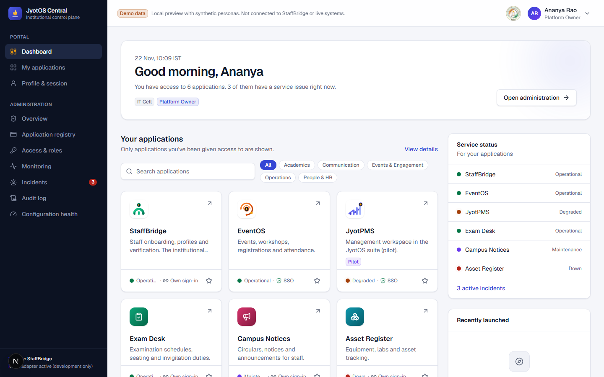

# JyotOS Central Overview


**Guide Quick Facts**

* **Estimated Reading Time:** 4 minutes
* **Target Audience:** All Institutional Personnel, Faculty, Coordinators, and Administrators
* **Applies To:** JyotOS Central (https://jyotos.vercel.app)
* **Last Updated:** 24 November 2026


Welcome to the **JyotOS Central** product documentation section.

**JyotOS Central** is the central institutional launchpad and portal for the JyotOS ecosystem, accessible at [https://jyotos.vercel.app](https://jyotos.vercel.app). It serves as the primary gateway where faculty, staff, coordinators, and administrators discover, launch, and manage access to campus applications.

*JyotOS Central dashboard displaying personalized greeting, active apps, and navigation controls.*

***

## What is JyotOS Central?

In a multi-application institutional environment, managing separate links, credentials, and access requests creates confusion. JyotOS Central solves this by providing:

* **A Single Starting Point:** All approved institutional applications—from staff rosters and event planning to academic timetables—are accessible through one unified interface.
* **Controlled Application Discovery:** Staff can see tools available to them, while discovering other campus systems displayed with locked cards.
* **Streamlined Access Governance:** Staff can request access to applications directly from their dashboard, and administrators can review and approve requests without manual configuration files.
* **Device-Level Personalization:** Users can bookmark favorite applications and choose between Auto, Light, and Dark visual themes.

***

## Who Uses JyotOS Central?

| Role | Primary Activities in Central |
|---|---|
| **Faculty & Staff Members** | Launch granted applications, request access to locked tools, and manage display preferences. |
| **Department Coordinators** | Quick access to department verification queues, roster tools, and student event portals. |
| **Institutional Leadership** | High-level visibility into ecosystem applications and operational service status. |
| **Platform Administrators** | Manage application registry, configure access audiences, assign platform roles, and inspect audit logs. |

***

## How to Sign In

JyotOS Central uses **StaffBridge Single Sign-On (SSO)**:

1. Open your browser and navigate to [https://jyotos.vercel.app](https://jyotos.vercel.app).
2. Click **Sign in with College Account**.
3. Select your official college Google account (`@amrolicollege.ac.in`).
4. If your staff profile is verified ("Ready") in StaffBridge, you will immediately reach your dashboard.

***

## Core Ecosystem Principles

### Central Governs Launch Access; Apps Govern Internal Permissions

A key design principle of JyotOS is the clear separation between portal access and application permissions:

* **Central Access:** Central determines *which applications* you can see and launch from the portal.
* **Application Permissions:** What you can do *inside* an application (such as approving leave, editing events, or grading) is managed independently by that specific application. Granting access in Central does not elevate your role inside the destination tool.

### Verified Identity Synchronization

When you sign in to Central, your display name and department affiliation are automatically synchronized from your verified StaffBridge profile for display purposes. Profile information is strictly read-only in Central; any updates must be submitted and approved in StaffBridge.

***

## Navigation Directory

Explore the dedicated Central guides:

* [Central Staff Guide](staff-guide.md): Everyday usage instructions for faculty and staff.
* [Central Administrator Guide](administrator-guide.md): Application catalog management, audiences, roles, and audit trails.
* [Central Troubleshooting](troubleshooting.md): Self-service resolutions for login alerts and locked cards.
* [Central Frequently Asked Questions](faq.md): Quick answers to common questions about Central.

***

**Last Updated:** 24 November 2026 | **Applies To:** JyotOS Central\
**Previous Step:** [← Getting help](../../start-here/getting-help.md) | **Next Step:** [Central Staff Guide →](staff-guide.md)\
**Related Guides:** [Central Staff Guide](staff-guide.md) · [Central Administrator Guide](administrator-guide.md) · [Central Troubleshooting](troubleshooting.md) · [Central FAQ](faq.md)
