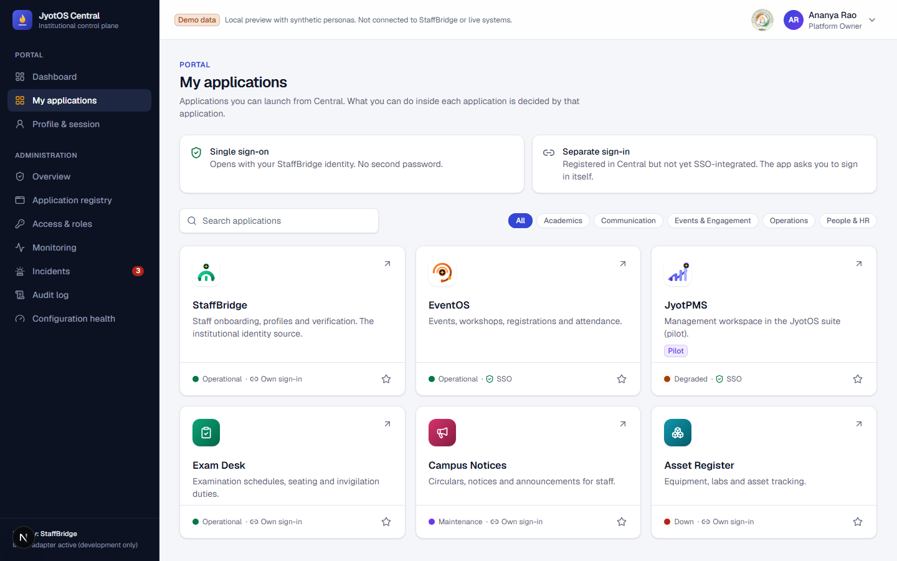
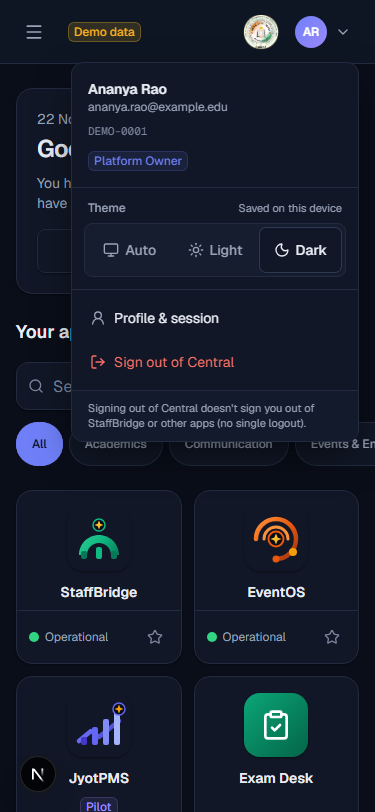

# JyotOS Central Staff Guide


**Guide Quick Facts**

* **Estimated Reading Time:** 4 minutes
* **Target Audience:** Institutional Faculty and Staff Members
* **Applies To:** JyotOS Central (https://jyotos.vercel.app)
* **Last Updated:** 24 November 2026


This guide provides step-by-step instructions for institutional faculty and staff using JyotOS Central for their daily work.

***

## Main Tasks Overview

As a staff member, you can use JyotOS Central to:

1. Launch available campus applications.
2. Discover tools and request access to locked cards.
3. Organize your dashboard by starring favorite applications.
4. Select your preferred display theme (Auto, Light, Dark).
5. Verify your synchronized profile and department details.

***

## 1. Launching Applications

When you log in to Central, your dashboard displays cards for applications available to you.

*Application cards display the application name, category, and launch link.*

* To launch an application, click on its card or the **Launch** button.
* The application opens in a new browser tab with your institutional identity authenticated automatically.

***

## 2. Requesting Access to Locked Applications

If an application is relevant to your academic or administrative work but displays a padlock indicator, you can request access directly:

1. Click on the locked application card.
2. A request modal dialog appears showing the application name and summary.
3. In the reason field, enter a brief justification for why you need access (e.g., *"Coordinator for upcoming cultural festival"*).
4. Click **Submit Request**.
5. Your request is queued for review by the Platform Owner and System Administrators. Once approved, the card unlocks automatically on your dashboard.

***

## 3. Managing Favorite Applications

To customize your dashboard and keep frequently used tools at your fingertips:

* Click the **Star icon** located on any application card.
* Starred applications are pinned to the **Favorites** section at the top of your launcher.
* To remove an application from favorites, click the star icon again.

***

## 4. Selecting Your Display Theme

JyotOS Central supports three viewing themes:

* **Auto (Default):** Dynamically follows your device's operating system setting.
* **Light:** Clean white and light-grey backgrounds with high-contrast text.
* **Dark:** Deep slate backgrounds optimized for evening or low-light viewing.

### How to Switch Themes

1. Click your user avatar or the menu icon in the top-right navigation bar.
2. In the menu, locate the **Theme** section.
3. Select your preferred option: **Auto**, **Light**, or **Dark**.

*Theme selection menu options.*

Your theme preference is saved directly on your current device and takes effect immediately without refreshing the page.

***

## 5. Reviewing Your Profile Information

To verify your account details:

1. Open the user menu at the top right of the navigation bar.
2. View your display name, official email address, and assigned department.
3. These details are synchronized from your verified StaffBridge profile in read-only form.
4. If your name or department assignment changes, update your profile in StaffBridge; the corrected information will reflect in Central at your next sign-in.

***

**Last Updated:** 24 November 2026 | **Applies To:** JyotOS Central\
**Previous Step:** [← JyotOS Central Overview](overview.md) | **Next Step:** [Central Administrator Guide →](administrator-guide.md)\
**Related Guides:** [Central Overview](overview.md) · [Central Troubleshooting](troubleshooting.md) · [Central FAQ](faq.md)
