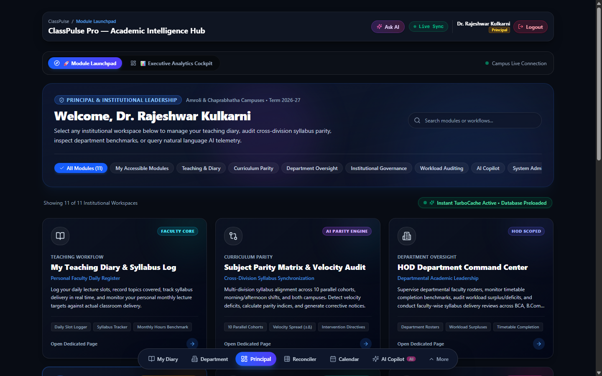

# ClassPulse Pro Overview


**Quick Facts**
* **Audience:** Teaching faculty, Department Coordinators, College Principal, System Administrators
* **Applies To:** ClassPulse Pro (Academic Workload Reconciliation & Timetable Delivery)
* **Access Method:** Official college email and password during pilot rollout
* **Availability Note:** ClassPulse Pro is being introduced to staff in stages.


ClassPulse Pro is the academic workload reconciliation, timetable delivery tracking, and cross-division curriculum delivery balance platform for Amroli College. It connects master timetables with daily classroom teaching records, providing clear operational visibility across academic departments and campus locations.

*ClassPulse Pro Module Launchpad providing direct access to academic delivery, parity, and workload workspaces.*

---

## Availability Note

ClassPulse Pro is being introduced to staff in stages. Initial access is available to designated pilot staff, department coordinators, and institutional leadership. More staff will get access over time.

### What Works Today / Coming Soon

| Status | Features Available |
| :--- | :--- |
| **What works today** | • Password sign-in for pilot staff with college email • Faculty teaching diary and session logging • Department coordinator faculty roster and delivery tracking • Principal executive delivery overview and 85% benchmark tracking • Faculty lecture reconciler and workload variance tracking • Cross-division subject delivery matrix |
| **Coming soon** | Single sign-on with JyotOS via StaffBridge launcher |

---

## Key Capabilities

ClassPulse Pro replaces manual paper registers and fragmented spreadsheets with structured digital workflows:

* **Teaching Diary Logging:** Faculty members record daily conducted lectures, subjects, divisions, and curriculum topics covered.
* **Timetable Delivery Tracking:** The system calculates delivered teaching hours against weekly contracted allocations for every instructor.
* **Department Workload Monitoring:** Department Coordinators track faculty delivery rates, workload surpluses, and lecture gaps.
* **Executive Institutional Overview:** College leadership monitors institutional delivery against the 85% benchmark, daily teaching velocity, and department comparisons.
* **Cross-Division Curriculum Alignment:** Pacing across parallel divisions and shifts is tracked to prevent syllabus gaps between student cohorts.

---

## Multi-Campus & Department Coverage

ClassPulse Pro covers academic operations across both college locations:

* **Amroli Campus** and **Chaprabhatha Campus**
* **Academic Departments:**
  * BBA & M.Com EM
  * B.Com EM & GM
  * BCA Noon (Afternoon Shift)
  * BCA Morning / B.Sc Data Science / M.Sc IT

---

## User Roles in ClassPulse Pro

ClassPulse Pro organizes operational responsibilities across four primary roles:

| Role | Scope | Primary Responsibilities |
| :--- | :--- | :--- |
| **Teaching Faculty** | Personal | Log daily conducted sessions, record topics covered, and view personal delivery rates. |
| **Department Coordinator (HOD)** | Department | Oversee departmental faculty rosters, track weekly loads, and review faculty lecture variances. |
| **College Principal** | College-wide | Monitor institutional delivery benchmarks, review cross-department performance, and review division delivery balance. |
| **System Administrator** | College-wide | Manage staff user access, upload master timetable files, and configure academic term dates. |

---

## Signing In to ClassPulse Pro

During the current pilot phase, staff members access ClassPulse Pro through direct credentials:

1. Open the ClassPulse Pro login page.
2. Enter your official college email ending in `@amrolicollege.ac.in`.
3. Enter your assigned pilot password.
4. Click **Sign In** to open your workspace.


**Coming soon:** Single sign-on through the JyotOS launcher and StaffBridge is not switched on yet. Pilot users sign in directly with their assigned password.


---

## Documentation Roster

Explore the role-based guides and reference pages to learn more:

* [Getting Started](getting-started.md) — First-time orientation, layout navigation, and date window filters.
* [My Teaching Portal](teaching-portal.md) — Guide for teaching faculty on logging lectures and reviewing diaries.
* [HOD Department Center](hod-department-center.md) — Guide for department coordinators on roster monitoring and delivery rates.
* [Principal Executive View](principal-executive-view.md) — Guide for institutional leadership on benchmarks and velocity tracking.
* [Faculty Lecture Reconciler](faculty-lecture-reconciler.md) — Detailed reference on expected hours, variances, and status classifications.
* [Subject Division Matrix](subject-division-matrix.md) — Reference on cross-division pacing and division spread indicators.
* [Troubleshooting](troubleshooting.md) — Solutions to common login, timetable link, and sync questions.
* [Frequently Asked Questions](faq.md) — Quick answers to common questions about calculations, targets, and exports.
