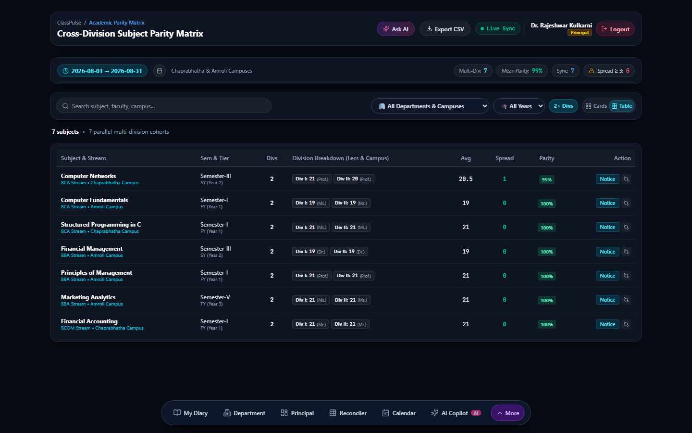

# Subject Division Matrix in ClassPulse Pro


**Quick Facts**
* **Audience:** Department Coordinators, College Principal, Academic Operations
* **Applies To:** ClassPulse Pro (Cross-Division Curriculum Alignment)
* **Scope:** Parallel division pacing and syllabus synchronization


The **Subject Division Matrix** is the curriculum synchronization tool in ClassPulse Pro. It tracks teaching pace across parallel divisions and campus shifts, ensuring that student cohorts enrolled in the same course progress at comparable rates.

---

## Why Cross-Division Alignment Matters

In collegiate institutions with large student enrollments, academic programs frequently divide incoming classes into multiple parallel divisions (such as Division A, B, and C, or Morning and Afternoon shifts).

Without centralized pacing visibility:
* One division may complete four syllabus units while a parallel division covers only two.
* Holiday schedules that fall on specific weekdays (e.g., recurring Monday holidays) can inadvertently delay one division's classes while leaving others unaffected.
* Students face unequal preparation ahead of standardized university examinations.

The Subject Division Matrix provides real-time visibility into these pacing variations, enabling early instructional adjustments.

---

## Subject Name Normalization

Different timetable schedules may record subject titles with minor typographical variations (such as `Financial Accounting-I`, `F.A. - 1`, or `ACC-101`).

ClassPulse Pro automatically resolves these entries to their canonical course identity:
* Parallel divisions are recognized and grouped together under the standard curriculum paper title.
* Distinct academic disciplines are preserved separately. For example, B.Sc Data Science subjects at Chaprabhatha Campus are tracked independently from BCA subjects to prevent artificial cohort grouping.

---

## Division Alignment Indicators and Metrics

*Track lecture counts across parallel divisions and monitor cross-division parity percentages.*

For every multi-division subject, the matrix calculates two core indicators:

### 1. Velocity Spread
The velocity spread measures the numerical difference between the division with the most conducted lectures and the division with the fewest:

$$\text{Velocity Spread} = \text{Maximum Division Lectures} - \text{Minimum Division Lectures}$$

* **Spread of 0 to 2 Lectures:** Indicates balanced, synchronized pacing between cohorts.
* **Spread of 3 or More Lectures:** Triggers a **Spread Alert**, indicating that one division is lagging behind its peers.

### 2. Delivery Balance Score
The balance score (displayed on screen as the Parity percentage) expresses the overall delivery balance across all divisions as a percentage:
* A high balance score (e.g., 85% to 100%) indicates well-synchronized progress.
* A low balance score indicates substantial variance in classroom delivery.

---

## Step-by-Step Instructions

### Step 1: Filtering by Department
1. Open the **Subject Division Matrix** from the navigation menu.
2. Select your academic department from the department filter dropdown.
3. Review the summary metrics showing total multi-division courses, average delivery balance rate, and the count of courses with active spread alerts.

### Step 2: Reviewing Course Cards
Each course card presents:
* **Subject Title & Code:** Standard academic paper name and curriculum code.
* **Delivery Balance & Spread:** Header badge indicating overall synchronization and numerical spread (e.g., on-screen badge `Parity: 88% (±2 lecs)`).
* **Division Breakdown:** Shows each division, its assigned instructor, and total conducted sessions to date.

### Step 3: Comparative Division Review
1. For courses displaying a spread alert, click the **Compare** action on the card.
2. The comparison view displays a head-to-head breakdown of conducted sessions, syllabus topics covered, and scheduled timetable slots for both divisions.
3. Identify the factors contributing to the pacing difference, such as cancelled sessions or unrescheduled holidays.

### Step 4: Generating an Equalization Directive
When a pacing gap exceeds three lectures:
1. Click the **Notice** button on the subject card.
2. The system generates an **Equalization Directive** identifying the lagging division, the current lecture gap, and recommended makeup sessions.
3. Department coordinators share this directive with the relevant instructor to schedule compensatory lectures before midterm evaluations.
