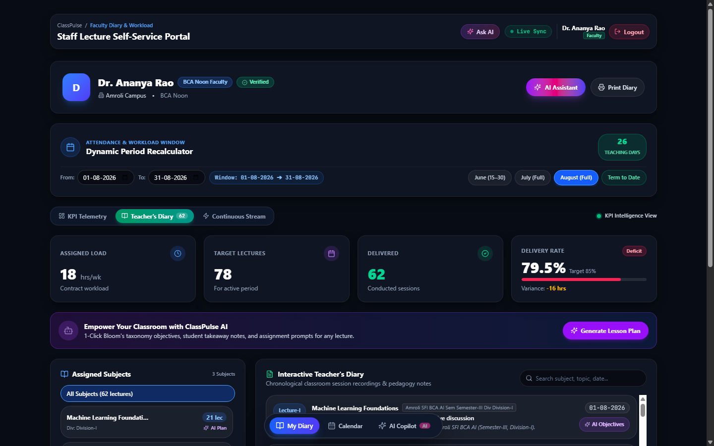

# My Teaching Portal in ClassPulse Pro


**Quick Facts**
* **Audience:** Teaching faculty, lecturers, and academic instructors
* **Applies To:** ClassPulse Pro (Personal Teaching Workspace)
* **Access Requirement:** Faculty role assignment and linked timetable profile


**My Teaching Portal** is the personal academic workspace where individual faculty members review their weekly teaching commitments, track conducted classroom sessions, inspect their digital diary, and monitor personal curriculum delivery progress.

---

## Workspace Overview

*Review contracted weekly hours, personal delivery rate, and logged sessions in the Interactive Teacher's Diary.*

When faculty members sign in to ClassPulse Pro, the portal provides immediate visibility into personal teaching commitments:

* **Weekly Timetable Load:** Your contracted teaching commitment expressed in weekly periods (e.g., `18 hrs/wk`).
* **Expected Sessions:** The calculated target number of lectures for the selected date window based on working days and your weekly load.
* **Conducted Sessions:** Total classroom, laboratory, and tutorial sessions recorded in your teaching diary.
* **Personal Delivery Rate:** The percentage of expected lectures delivered:
  $$\text{Delivery Rate} = \left( \frac{\text{Conducted Sessions}}{\text{Expected Sessions}} \right) \times 100$$
  * A rate of **85% or higher** meets institutional benchmarks.
  * A rate below **85%** indicates a pacing deficit to address before term completion.

---

## Timetable Linking Status

At the top of the portal, an indicator badge confirms your timetable connection status:

* **Timetable Linked (Green):** Your profile is connected to the institutional master timetable. Expected weekly loads and subject assignments reflect official college allocations.
* **Timetable Not Linked (Amber):** Your profile has not yet been matched to master timetable allocations. In this state, conducted diary sessions are still logged, but target comparisons remain pending coordinator assignment. If you see this notice, contact your Department Coordinator.

---

## Interactive Teacher's Diary

The **Interactive Teacher's Diary** displays a chronological register of all conducted sessions logged for your courses:

### Session Details Displayed
Every session record includes:
* **Date & Day:** The date and day of the week the session took place.
* **Period Slot:** The specific time period from the master schedule.
* **Class & Division:** The academic program, year, and division taught (e.g., `BCA Sem-1 Div-A`).
* **Subject Name & Code:** The curriculum course title and paper code.
* **Topics Covered:** The specific syllabus units, chapters, or practical exercises addressed during the lecture.
* **Session Type:** Identifies whether the lecture matched the regular master timetable schedule or was conducted as an extra, remedial, or substitute session.

---

## Reviewing and Printing Your Diary

Faculty members can generate formal records of their teaching activity for departmental reviews:

1. Select your target month or date range in the **Date Tracker Bar**.
2. Review the list of conducted lectures in the diary table.
3. Verify that all conducted sessions and covered topics are accurately logged.
4. Click the **Print Diary** button in the top action bar to open a print-formatted view suitable for physical printing or saving as a PDF.
