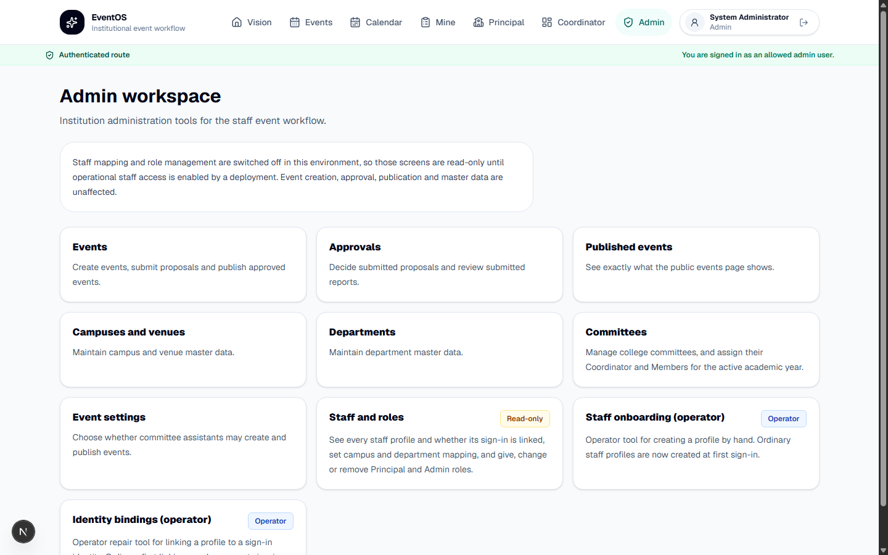
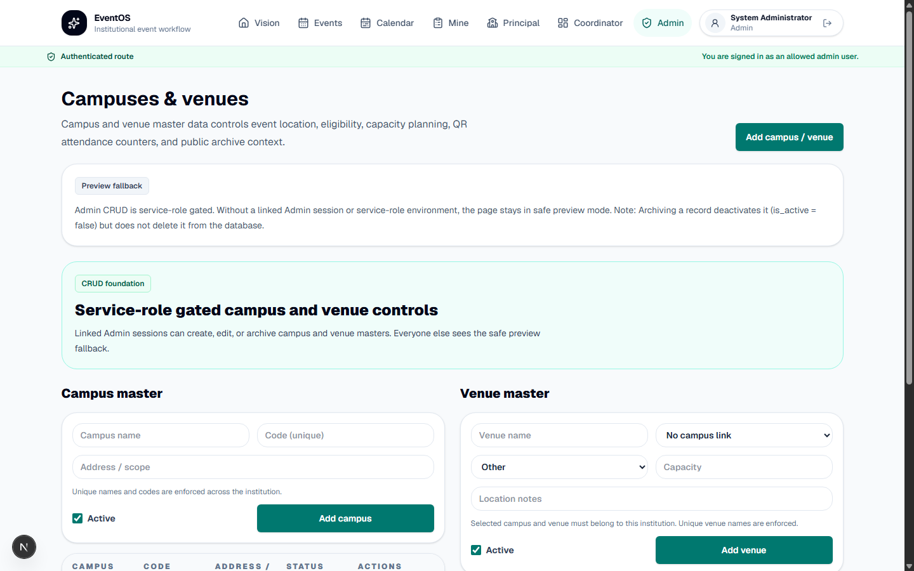

# Administrator Guide for EventOS


**Quick Facts**
* **Audience:** System Administrators, College IT Operations
* **Applies To:** EventOS (Administrator Console)
* **Scope:** College-wide master data, user mapping, attendance exceptions, and archival


This guide explains how system administrators configure institutional master data, manage user role assignments, handle session attendance exceptions, and oversee final event archival.

---

## Administrator Console Overview

*Administrator workspace displaying core governance tools for institutional events, approvals, and master records.*

The Administrator Console provides college-wide administrative governance over EventOS operations:

* **Master Data Management:** Campuses, departments, venues, and committees.
* **User & Role Governance:** Role assignments and campus/department mappings.
* **Attendance Exceptions (Coming soon):** Session-level manual overrides and attendance audit logs.
* **Event Archival (Coming soon):** Preservation of completed events and approved reports.

---

## Institutional Master Data Management

*Master data management screen for campus facilities, venue capacity, and location settings.*

Administrators maintain the core organizational entities referenced across all events:

### 1. Campuses and Departments
* Ensure all active institutional campuses (**Amroli Campus** and **Chaprabhatha Campus**) are configured.
* Maintain academic and administrative departments mapped to their respective campuses.

### 2. Venues and Facilities
* Configure campus auditoriums, seminar halls, conference rooms, laboratories, and outdoor grounds.
* Specify seating capacities and venue availability parameters.

### 3. Committees and Event Categories
* Maintain institutional committees, cells, clubs, and professional associations.
* Configure standard event categories (e.g., Academic Conferences, Workshops, Faculty Development Programs, Cultural Events, Sports Tournaments).

---

## User Mapping and Role Governance

EventOS operates with independent role-based permissions mapped from verified StaffBridge identities:

1. **Staff Identity Ingestion:** Verified staff records from StaffBridge are linked to EventOS profiles.
2. **Role Assignment:** Administrators assign operational roles based on institutional duties:
   * **Administrator:** Full administrative governance across all campuses.
   * **Principal:** Executive approval authority for campus-specific event proposals and reports.
   * **Department Coordinator:** Authority to draft proposals, coordinate sessions, and submit reports within their assigned campus.
   * **Staff Member:** Default self-service access to discover events, register, and attend sessions.
3. **Organizational Mapping:** Administrators ensure each staff profile is correctly mapped to an institutional campus and department. Staff profiles without department mappings cannot register for department-restricted events.

---

## Attendance Exceptions and Overrides


**Coming soon:** Attendance exception handling and session window reopening are not available yet.


System administrators will be able to reopen closed attendance windows or record attendance exceptions with recorded administrative reasons when technical anomalies occur.

---

## Event Cancellation and Archival

Administrators share cancellation and archival responsibilities with campus leadership:

### Event Cancellation
* Administrators can cancel an individual session or an entire event when required, recording an administrative reason.
* Cancellation locks all active registrations and updates the event status across all public and internal views.

### Event Archival


**Coming soon:** Event archival is not available yet.


Administrators will move completed events with approved report packages into the college archive for institutional record-keeping.
