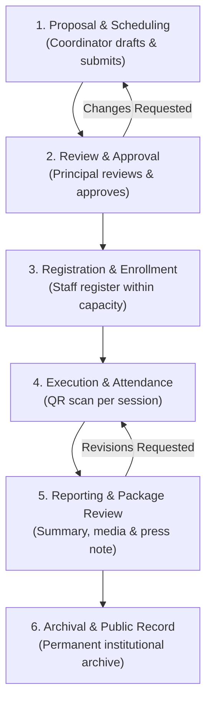

# Event Lifecycle in EventOS


**Quick Facts**
* **Audience:** All EventOS users (Staff, Coordinators, Principals, Administrators)
* **Applies To:** EventOS Governance & Workflow
* **Lifecycle Phases:** Exactly six sequential phases from proposal to archival


Every institutional event managed in EventOS advances through six sequential lifecycle phases. This structured workflow ensures transparency, administrative governance, accurate attendance tracking, and permanent institutional record-keeping.

---

## Event Lifecycle Diagram

---

## Detailed Phase Breakdown

### Phase 1: Proposal and Scheduling
* **Initiator:** Department Coordinator or Committee Convener.
* **Actions:** The organizer drafts the event details, including academic objectives, multi-day session timings, campus venue, target audience, department eligibility rules, registration window, and optional capacity limits.
* **Outcome:** The proposal is submitted to the campus Principal for formal review.

### Phase 2: Review and Approval
* **Reviewer:** Campus Principal or designated executive authority.
* **Actions:** The Principal evaluates the proposal against academic priorities, campus venue availability, and scheduling conflicts.
* **Decisions:**
  * **Approved:** The event transitions to published status and appears in the event catalog.
  * **Changes Requested:** The proposal returns to the coordinator with written feedback for revisions.
  * **Rejected:** The proposal is closed.
* **Revision Handling:** If an organizer updates an already-approved event, the earlier approved details remain publicly visible until the Principal approves the new revision.

### Phase 3: Registration and Enrollment
* **Participants:** Eligible faculty and staff members.
* **Actions:** Staff discover the published event and register online. Registration is completed once for the entire event and covers all included sessions.
* **Rules Enforced:**
  * Campus and department eligibility criteria are strictly checked.
  * Registrations are accepted only while the registration window remains open.
  * If capacity is reached, additional eligible applicants are placed on a first-come, first-served waiting list.
  * Self-service cancellation is permitted before the registration window closes.

### Phase 4: Execution and Attendance Tracking
* **Operators:** Department Coordinator and assigned same-campus helpers.
* **Actions:** At each scheduled session, the attendance window is opened. Attendees present their personal digital QR passes, which are scanned by event organizers.
* **Rules Enforced:**
  * Attendance is recorded independently for each individual session.
  * Helpers are restricted strictly to scanning attendee passes.
  * Coordinators can extend the active attendance window if needed.
  * System administrators can record manual exceptions or reopen closed windows with audit tracking.

### Phase 5: Reporting and Package Approval
* **Compiler:** Department Coordinator.
* **Reviewer:** Campus Principal or System Administrator.
* **Actions:** Following event conclusion, the coordinator compiles a unified report package:
  * Executive event summary.
  * Structured highlights across up to six thematic sections.
  * Verified attendance breakdown (staff, students, volunteers).
  * Up to six curated photographs with descriptive captions.
  * Official institutional press note for college records and media release.
* **Outcome:** The Principal reviews and approves the package as a single combined submission. If edits are made, the package must be re-approved.

### Phase 6: Archival and Public Record
* **Authority:** System Administrator and Institutional Leadership.
* **Actions:** With the report package approved, the event is permanently closed and archived.
* **Outcome:** The event record and approved public report content remain searchable in the institutional event archive, while private participant information remains protected.

---

## Lifecycle Phase Matrix

| Phase | Primary Actor | Key Inputs & Actions | Output State |
| :--- | :--- | :--- | :--- |
| **1. Proposal** | Department Coordinator | Title, agenda, venue, dates, eligibility, capacity | Proposal Submitted |
| **2. Approval** | Campus Principal | Proposal evaluation, change requests, approval | Event Published |
| **3. Registration** | Staff Participants | Single registration per event, waitlist enrollment | Enrolled Participant |
| **4. Attendance** | Coordinator & Helpers | QR pass scanning, session check-ins, manual fallback | Session Attended |
| **5. Reporting** | Coordinator & Principal | Narrative, sections, photo captions, press release | Report Approved |
| **6. Archival** | System Administrator | Record verification, long-term preservation | Archived Event |
