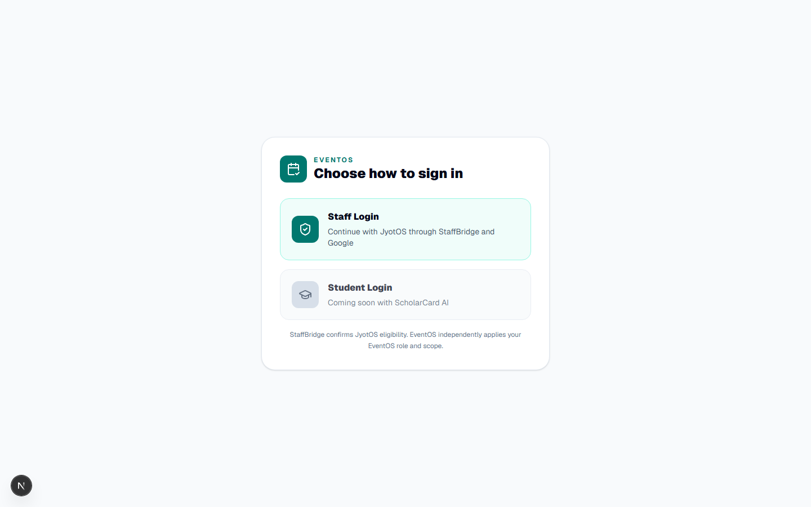

# Staff Guide for EventOS


**Quick Facts**
* **Audience:** All teaching faculty and non-teaching staff members
* **Applies To:** EventOS (Participant Journey)
* **Access Requirement:** Verified staff account via StaffBridge Single Sign-On


This guide explains how faculty and staff members discover institutional events, complete registration, and manage event registrations.

---

## Finding Events

*EventOS login options dialog showing Staff Login and Student Login choices.*

Staff members can browse upcoming, ongoing, and archived college events through the EventOS catalog:

1. Sign in to EventOS using your college Google account (`@amrolicollege.ac.in`).
2. Open the **Events** directory from the main navigation menu.
3. Browse the event catalog or apply filters:
   * **Campus Filter:** View events organized at Amroli Campus or Chaprabhatha Campus.
   * **Category Filter:** Filter by Workshops, Seminars, Faculty Development Programs, Cultural Functions, or Sports.
   * **Timeframe:** View upcoming events, currently running events, or past events.
4. Click on any event card to view the complete schedule, session details, venue, organizing committee, and eligibility criteria.

---

## Registering for an Event

When you find an event you wish to attend:

1. Open the event details page while registration is open.
2. Review the eligibility requirements (such as target departments or campus restrictions).
3. Click **Register for Event**.
4. The system validates your institutional staff profile against the event's eligibility rules. Upon validation, your registration is confirmed.

---

## Registration and Eligibility Rules

* **Single Registration per Event:** You register once for the entire event. Your confirmed registration grants you access to all eligible sessions included within that event schedule.
* **Campus & Department Eligibility:** Some events are open college-wide, while others are restricted to specific academic departments or campuses. Staff members whose profiles have not been mapped to a department or campus will be blocked from department-restricted events.
* **Registration Time Window:** Events specify precise registration opening and closing dates and times. Registration is disabled before the opening time and after the closing time.
* **Capacity Limits & Waiting List:** When an event has a maximum participant capacity, registrations are accepted until capacity is reached. If a waiting list is enabled, additional eligible registrations are placed on a first-come, first-served waiting list. If an enrolled participant cancels, waitlisted participants are automatically promoted in order.

---

## Managing Your Registrations

To review your registered events:

1. Open **My Registrations** from the navigation menu.
2. View your active registrations, event dates, venues, and registration statuses.
3. Open any active event to view event details and schedule.

---

## Cancelling a Registration

If your schedule changes and you can no longer attend:

1. Navigate to **My Registrations**.
2. Select the event and click **Cancel Registration**.
3. Confirm your cancellation.
4. Your seat is immediately released, allowing the next waitlisted staff member to be enrolled.


**Cancellation Policy**
Self-service cancellation is permitted only while the event registration window remains open. Once registration closes or attendance has been marked for any session, registrations become locked and cannot be cancelled online.


---

## Attending Event Sessions


**Coming soon:** Attendance verification and digital QR passes are not available yet.


When attendance features become available, participants will display a personal QR pass from their registered event to be scanned at the session entrance.
