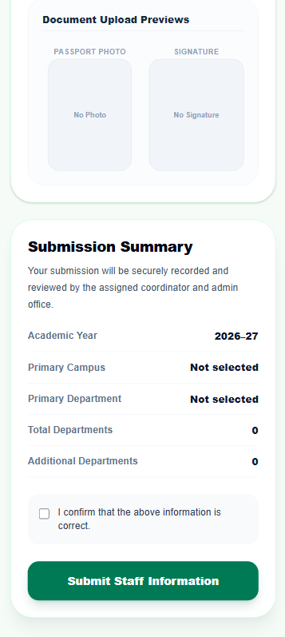

# Complete Your Staff Onboarding

This guide provides a detailed walkthrough for filling out the StaffBridge staff onboarding form, uploading identification media, and completing registration.

***

## Step-by-Step Registration Procedure

### Step 1: Personal and Contact Details

Navigate to `/staff/onboarding` on your mobile or desktop browser:

1. **Full Name:** Enter your full legal name formatted in proper title case (e.g. `Dr. Hiral A. Patel`).
2. **Gender:** Select `Male` or `Female`.
3. **Date of Birth:** Select your date of birth using the calendar picker (`dd-mm-yyyy`).
4. **Primary Mobile Number:** Enter your active 10-digit primary mobile number.
5. **Alternate Mobile Number:** (Optional) Enter a secondary 10-digit mobile number if available.
6. **Official College Email:** Enter your institutional email address ending in `@amrolicollege.ac.in`. Personal email addresses (`@gmail.com`) are rejected.
7. **Emergency Contacts:** Enter your emergency contact person's name and their 10-digit contact number.
8. **Residential Address:** (Optional) Enter your residential address including pincode.

### Step 2: Professional Details and Qualifications

1. **Staff Category:** Select your employment classification (such as Permanent Teaching, Adhoc Teaching, Administrative, Library, Support, or Lab Technician).
2. **Designation:** Select your official appointment title (such as Assistant Professor, Associate Professor, Professor, Accountant, Clerk, or Lab Assistant).
3. **Date of Joining:** Select the official date you joined the institution.
4. **Area of Expertise:** Enter your subject specialization or primary domain (e.g. `Accountancy & Taxation`, `Computer Applications`).
5. **Qualifications:** Check all degrees and eligibility tests you have completed (such as B.Com, M.Com, Ph.D., NET, GSET). If your qualification is not listed, check **Other** and specify it in the text field.

### Step 3: Campus and Department Mapping

1. **Primary Campus:** Select **Amroli Campus** or **Chaprabhatha Campus**.
2. **Primary Department:** Select your primary academic or administrative department from the list filtered for your chosen campus.
3. **Additional Departments:** (Optional) If you hold appointments or teaching assignments in other departments across campuses, check all applicable departments from the additional departments list.

### Step 4: Photo, Signature, and Consent

1. **Blood Group:** Select your blood group from the dropdown (`A+`, `A-`, `B+`, `B-`, `AB+`, `AB-`, `O+`, `O-`, or `Not Known`).
2. **Passport Photo:** Upload a front-facing portrait photo (JPEG or PNG, under 2 MB) with a plain, light background.
3. **Signature Image:** Either upload an existing signature image file (JPEG or PNG, under 1 MB) or select **Draw Digital Signature** to sign directly on screen using your finger, stylus, or mouse.
4. **Media Consent:** Check the mandatory authorization box: _"I confirm that my uploaded photo, signature, and blood group may be used for authorized institutional staff records, verification, ID card preparation, and administrative purposes."_

### Step 5: Review and Submit Registration

Review the **Submission Summary** card at the bottom of the form before submitting:

1. Verify that your academic year (`2026-27`), selected campus, and department mappings are correct.
2. Check the confirmation checkbox: _"I confirm that the above information is correct."_
3. Click **Submit Staff Information**.

***

## Post-Submission Confirmation & Receipt

Once submitted, the system automatically:

1. Assigns you a unique **Staff Reference ID** (such as `STAFF-2026-0086`).
2. Sets your record status to **Submitted**.
3. Displays a submission success screen with a **Download PDF Receipt** button. Click this button to save a copy of your onboarding receipt.

Your assigned Department Coordinator and System Administrator will review your submission. You can track review progress by signing in to your personal dashboard at `/staff/dashboard`.

***

**Related Guides:** [Personal & Employment Information](personal-and-employment-information.md) · [Photo & Signature Guidelines](photo-and-signature-guidelines.md) · [Understanding Profile Status](understanding-profile-status.md)
