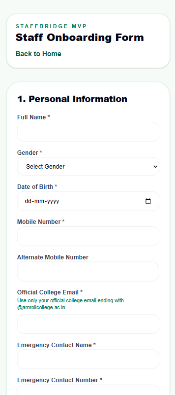

# Getting Started with StaffBridge

This guide provides a preparation checklist and a high-level overview of the StaffBridge staff onboarding registration process.

***

## Pre-Registration Checklist

Before beginning your registration, make sure you have the following details and documents ready:

* **Official Institutional Email:** Your active college Google account ending in `@amrolicollege.ac.in`.
* **Personal & Emergency Contact Details:** Full legal name, date of birth, blood group, 10-digit primary mobile number, alternate mobile number, and emergency contact name and number.
* **Employment Information:** Official designation, primary campus, primary department, staff category, and date of joining.
* **Academic Qualifications:** List of completed degrees (such as B.A., M.A., B.Com, M.Com, BCA, MCA, Ph.D., NET, GSET).
* **Passport Photo:** A clear, front-facing portrait photo file (JPEG or PNG, under 2 MB).
* **Signature Image:** A clean scanned signature image file (under 1 MB) or the ability to draw your digital signature on screen.

***

## Onboarding Registration Interface

The staff onboarding registration form is publicly accessible and does not require prior login. You only need your official institutional email address to complete registration.



***

## The 6-Step Onboarding Journey

```
1. Personal Information ──► 2. Professional Info ──► 3. Campus & Department ──► 4. Photo & Signature ──► 5. Review ──► 6. Receipt
```

1. **Step 1: Open Onboarding Form:** Open the staff onboarding form on your desktop or mobile web browser.
2. **Step 2: Enter Personal Details:** Fill in your full name, date of birth, mobile numbers, official institutional email, and emergency contacts.
3. **Step 3: Enter Professional Information:** Select your staff category and designation, enter your date of joining, and select all applicable qualifications.
4. **Step 4: Map Campus and Departments:** Choose your primary campus (**Amroli Campus** or **Chaprabhatha Campus**), select your primary department, and check any additional department appointments.
5. **Step 5: Upload Photo and Signature:** Select your blood group, upload your passport photograph, upload or draw your digital signature, and check the media consent box.
6. **Step 6: Review and Download Receipt:** Confirm your summary details, click **Submit Staff Information**, and save your PDF submission receipt containing your unique **Staff Reference ID** (formatted as `STAFF-2026-XXXX`).

***

**Related Guides:** [Complete Your Staff Onboarding](complete-onboarding.md) · [Personal & Employment Information](personal-and-employment-information.md) · [Photo & Signature Guidelines](photo-and-signature-guidelines.md)
