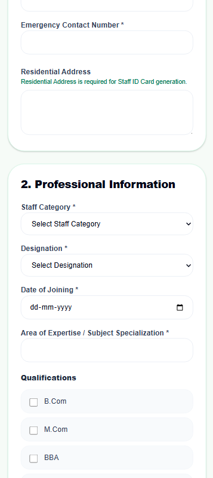
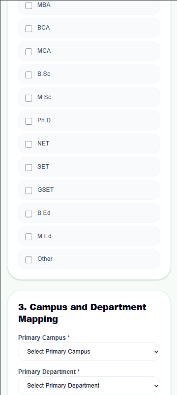
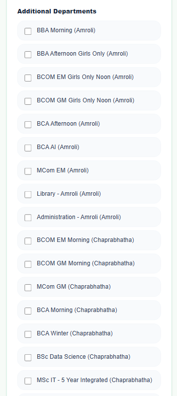

# Personal and Employment Information

This reference guide explains each personal, contact, professional, and department field collected during StaffBridge onboarding.

***

## 1. Personal and Contact Information

| Field Name | Required? | Constraints & Format | Description |
| :--- | :---: | :--- | :--- |
| **Full Name** | Yes | Free text, title case | Your legal name as recorded on educational certificates (e.g. `Dr. Hiral A. Patel`). |
| **Gender** | Yes | Selection: `Male`, `Female` | Official gender classification. |
| **Date of Birth** | Yes | Date picker (`YYYY-MM-DD`) | Date of birth for identity records. |
| **Primary Mobile Number** | Yes | Exactly 10 numeric digits | Your active mobile number for communication and institutional SMS alerts. |
| **Alternate Mobile Number** | No | 10 numeric digits (optional) | A secondary phone number where you can be reached. |
| **Official College Email** | Yes | `@amrolicollege.ac.in` domain | Your institutional Google account. Personal email addresses (`@gmail.com`) are not accepted. |
| **Emergency Contact Name** | Yes | Free text | Name of a family member, spouse, or guardian to contact in emergencies. |
| **Emergency Contact Number** | Yes | Exactly 10 numeric digits | Phone number of the designated emergency contact. |
| **Residential Address** | No | Textarea with 6-digit pincode | Residential address for campus communication records. |

***

## 2. Professional Details and Qualifications

| Field Name | Required? | Constraints & Format | Description |
| :--- | :---: | :--- | :--- |
| **Staff Category** | Yes | Master selection | Employment classification: Permanent Teaching, Adhoc Teaching, Administrative, Library, Support, Lab Technician, Visiting Faculty, or Temporary. |
| **Official Designation** | Yes | Master selection | Official job title: Principal, Professor, Associate Professor, Assistant Professor, Registrar, Accountant, Clerk, Lab Assistant, Peon, etc. |
| **Date of Joining** | Yes | Date picker (`YYYY-MM-DD`) | Official date of appointment at the institution. |
| **Area of Expertise** | Yes | Free text | Academic specialization or functional area (e.g. `Financial Accounting`, `Machine Learning`). |
| **Qualifications** | Yes | Multi-select checkboxes | Academic degrees completed: B.A., M.A., B.Com, M.Com, B.Sc, M.Sc, BCA, MCA, BBA, MBA, B.Ed, M.Ed, LL.B., LL.M., M.Phil, Ph.D., NET, SLET, GSET, Diploma, Other. |
| **Other Qualification** | Conditional | Required if `Other` is selected | Specify any degree, certification, or credential not covered in the standard checklist. |

***

## 3. Campus and Department Mapping

* **Primary Campus:** Select your primary workplace:
  * **Amroli Campus** (Main Campus)
  * **Chaprabhatha Campus** (Extension Campus)
* **Primary Department:** The primary academic department or administrative unit to which your position is appointed. Selecting a primary campus automatically filters the primary department list.
* **Additional Departments:** (Optional) If you have joint teaching responsibilities, teach cross-faculty courses, or handle duties across multiple departments or campuses, check all relevant departments in this list.

***

**Related Guides:** [Complete Your Staff Onboarding](complete-onboarding.md) · [Photo & Signature Guidelines](photo-and-signature-guidelines.md) · [Understanding Profile Status](understanding-profile-status.md)
