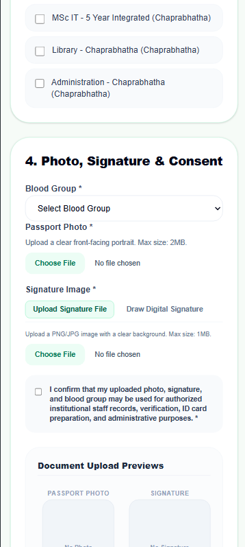

# Photo and Signature Guidelines

This guide details quality standards, upload instructions, and format requirements for identification media in StaffBridge.

***

## Identification Media Section

When completing onboarding at `/staff/onboarding` or updating media in response to a correction request, you will use the identification media interface:

***

## Passport Photograph Requirements

Your passport photo is printed on your official college ID card and displayed in the institutional directory:

* **Format:** JPEG (`.jpg`, `.jpeg`) or PNG (`.png`).
* **Maximum File Size:** Under 2 MB.
* **Composition:** Clear, front-facing portrait with your face centered and looking directly at the camera. Both eyes and ears should be clearly visible.
* **Background:** Plain white or light-colored background. Avoid patterned backgrounds, outdoor scenery, or shadows behind your head.
* **Expression & Attire:** Formal or semi-formal academic attire. Neutral expression or natural smile.
* **Eyewear:** Regular prescription spectacles are permitted if lenses are non-tinted and there is no glare. Sunglasses, hats, or fashion accessories that obscure your face are not permitted.

***

## Digital Signature Requirements

Your signature image is embedded onto official documents and the reverse side of your institutional staff ID card:

* **Upload Option:**
  * Sign with a dark blue or black ink pen on clean, unlined white paper.
  * Take a clear photo or scan of the signature, crop closely around the signature text, and upload it as a PNG or JPEG file (under 1 MB).
* **On-Screen Drawing Option:**
  * Select **Draw Digital Signature** on the form.
  * A touch-enabled canvas opens on your screen. Use your finger or a stylus on a mobile/tablet screen, or your mouse on a desktop, to sign smoothly inside the white box.
  * If you make a mistake, tap **Clear Canvas** to erase and redraw.
  * Tap **Save Signature** once you are satisfied with the result.

***

## Blood Group and Media Consent

* **Blood Group:** Select your blood group from the dropdown (`A+`, `A-`, `B+`, `B-`, `AB+`, `AB-`, `O+`, `O-`, or `Not Known`). Blood group information is printed on the physical and digital ID card for emergency medical situations.
* **Mandatory Consent Checkbox:** You must check the authorization box confirming that your submitted photograph, signature, and blood group may be used for authorized institutional staff records, verification, and ID card preparation.

***

**Related Guides:** [Complete Your Staff Onboarding](complete-onboarding.md) · [Personal & Employment Information](personal-and-employment-information.md) · [Understanding Profile Status](understanding-profile-status.md)
