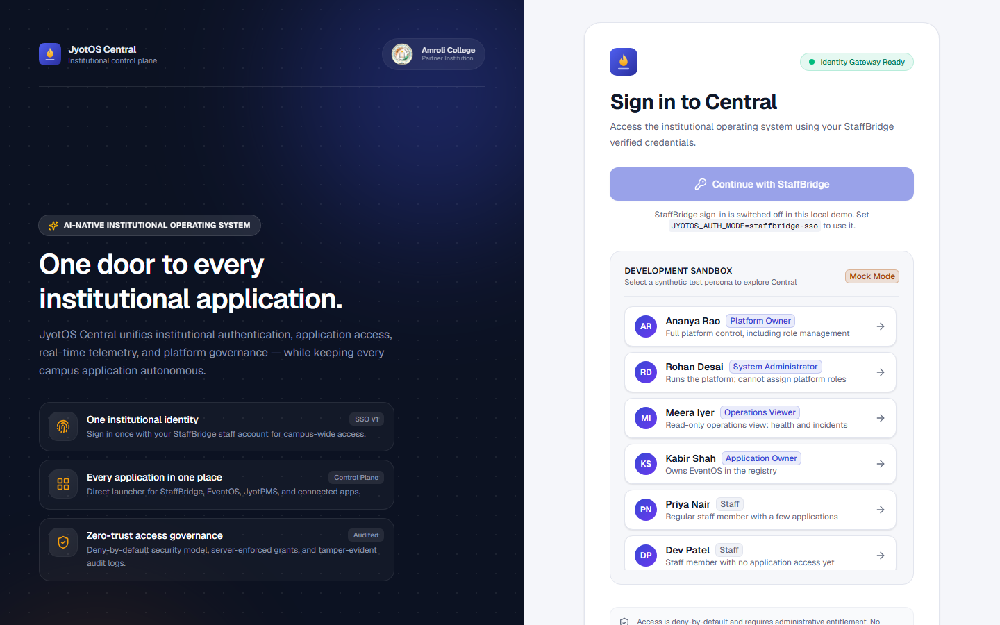

# Sign in Once


**Guide Quick Facts**

* **Estimated Reading Time:** 4 minutes
* **Target Audience:** All Institutional Faculty, Staff, and Administrators
* **Applies To:** JyotOS Ecosystem & StaffBridge SSO
* **Last Updated:** 24 November 2026


The JyotOS ecosystem uses **Single Sign-On (SSO)** powered by StaffBridge. You sign in once with your official institutional account, without creating or remembering separate passwords for different applications.

***

## Sign-In Requirements

Before you can sign in to JyotOS applications, ensure you meet the following requirements:

1. **Official Institutional Google Account:** You must use your assigned college Google workspace email address (ending in `@amrolicollege.ac.in`). Personal accounts (`@gmail.com`) are rejected.
2. **"Ready" Staff Profile:** Your StaffBridge profile must have completed onboarding and received administrator verification.

### What is a "Ready" Profile?

A staff profile is considered **Ready** when all three conditions are met in StaffBridge:

* **Profile Completion:** Furnished (all personal, contact, and employment information submitted).
* **Verification Status:** Admin Verified (reviewed and approved by your Department Coordinator and System Administrator).
* **Account Status:** Active.

***

## Step-by-Step Sign-In Instructions

### Step 1: Open the Application or Central Portal

Open your web browser and navigate to **JyotOS Central** at [https://jyotos.vercel.app](https://jyotos.vercel.app) or your specific application URL.

### Step 2: Click the Sign-In Button

On the login page, click **Sign in with College Account** or **Continue with StaffBridge**.

*JyotOS Central sign-in card with institutional StaffBridge Single Sign-On.*

### Step 3: Authenticate with Google

When prompted by the Google sign-in screen:

1. Select or enter your institutional Google email address (`@amrolicollege.ac.in`).
2. Enter your institutional Google password.
3. Complete two-factor verification if enabled for your account.

### Step 4: Access Your Dashboard

Upon successful verification, StaffBridge confirms who you are and sends you directly to your dashboard.

***

## What to Do if You Are Not "Ready"

If your account cannot sign in or displays an access alert, check the following steps:

* **Incomplete Onboarding:** If you have not yet finished onboarding, sign in to StaffBridge directly to submit your required employment information, profile photo, and signature.
* **Pending Department Review:** If your profile is submitted but awaiting verification, contact your Department Coordinator to complete the review.
* **Correction Requested:** If a coordinator requested corrections on your submitted data, check your notifications in StaffBridge, make the necessary updates, and resubmit.
* **Inactive Status:** If your profile is marked suspended or inactive, contact your institutional IT administrator.

***

## Common Sign-In Alerts


**Wrong Email Domain**\
If you select a personal Google account during sign-in, the system displays an authorization failure. Ensure you select your official institutional account ending in `@amrolicollege.ac.in`.



**Session Timeout**\
The sign-in handshake window is time-limited. If you leave the login page open for an extended period before completing authentication, click **Try Again** or return to [https://jyotos.vercel.app](https://jyotos.vercel.app) to start a fresh session.


***

**Last Updated:** 24 November 2026 | **Applies To:** JyotOS Ecosystem\
**Previous Step:** [← What is JyotOS?](what-is-jyotos.md) | **Next Step:** [The app launcher →](the-app-launcher.md)\
**Related Guides:** [The app launcher](the-app-launcher.md) · [Your first 5 minutes](your-first-5-minutes.md) · [Understanding Profile Status](../products/staffbridge/understanding-profile-status.md)
