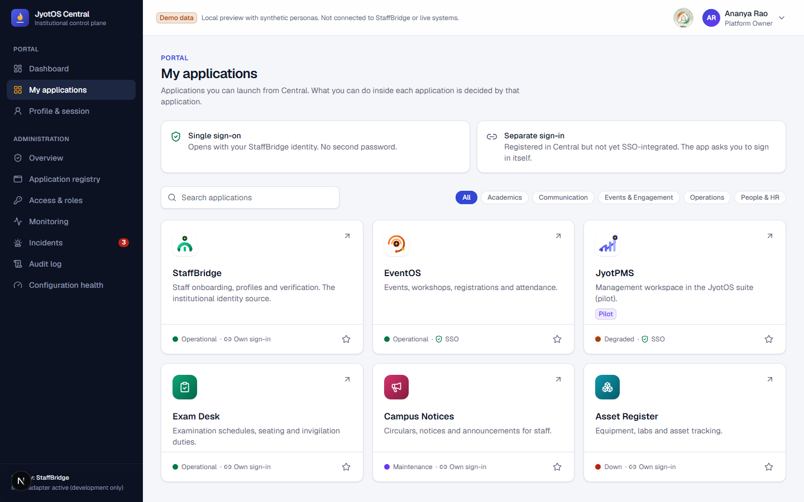
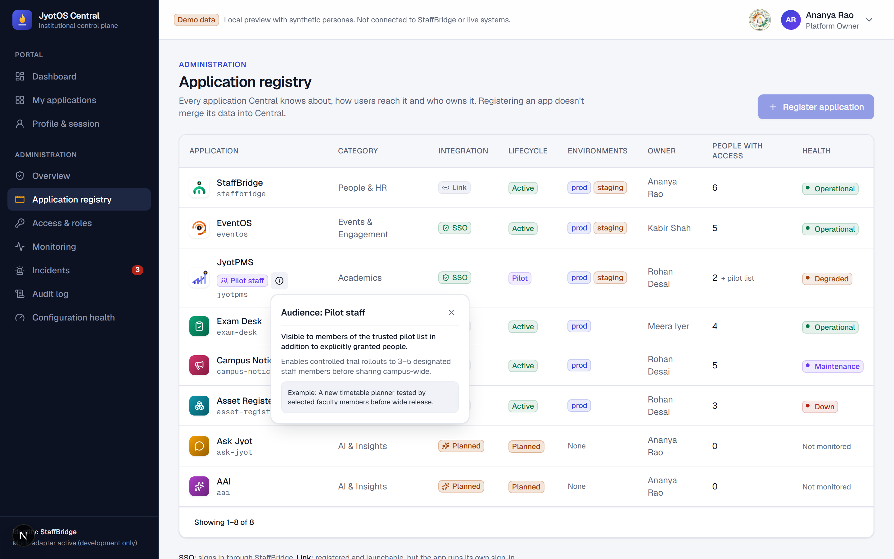
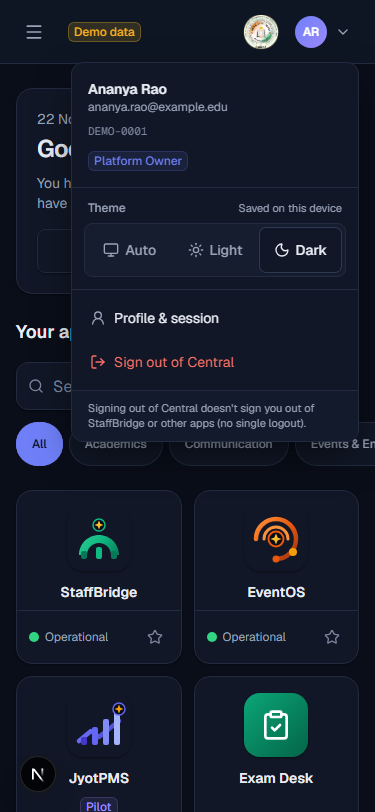

# The App Launcher


**Guide Quick Facts**

* **Estimated Reading Time:** 4 minutes
* **Target Audience:** All Institutional Faculty, Staff, and Administrators
* **Applies To:** JyotOS Central (https://jyotos.vercel.app)
* **Last Updated:** 24 November 2026


**JyotOS Central** is the unified web launcher and portal for the JyotOS ecosystem. Located at [https://jyotos.vercel.app](https://jyotos.vercel.app), Central provides a single institutional homepage where staff discover, launch, and request access to campus applications.

***

## The Launcher Interface

When you sign in to JyotOS Central, your dashboard presents the institutional application catalog:

*JyotOS Central App Launcher showing available and discoverable institutional applications.*

The launcher includes the following key areas:

1. **Header Navigation:** Displays the institutional logo, current time greeting, theme toggle, and user profile menu.
2. **Favorites Bar:** Pins your most frequently accessed applications for fast launching.
3. **Application Grid:** Shows institutional applications organized by category (Core & OS, Operations, Academics, AI Support).
4. **Search & Filter:** Allows quick filtering of applications by keyword or functional area.

***

## Available vs. Locked Applications

Applications in the launcher appear in one of two states:

* **Available Applications:** Applications you have active permission to use display a standard card with an active launch link. Clicking the card opens the application in a new browser tab.
* **Locked Applications:** Applications that are visible for discovery but not yet granted to your account display a padlock indicator. You can explore their purpose and request access directly from the card.

*Audience settings determine whether an application is available to all staff, pilot teams, or explicit grants.*

***

## How to Request Access

If you need access to an application displaying a lock badge:

1. Click on the locked application card in the launcher.
2. A request window opens showing the application name and summary.
3. Enter a short justification in the request box (e.g., *"Assigned to the NAAC criteria documentation team"*).
4. Click **Submit Request**.
5. Your request is delivered to institutional administrators. Once approved, the card automatically unlocks on your dashboard.

***

## Selecting Your Display Theme

JyotOS Central provides three display theme modes:

* **Auto (Default):** Follows your operating system's light or dark mode setting automatically.
* **Light:** Clean white and light grey interface with high contrast.
* **Dark:** Deep navy and slate interface designed for low-glare viewing.

### How to Change Themes

1. Click your profile avatar in the top-right navigation bar to open the user menu.
2. Locate the **Theme** section.
3. Click your preferred option: **Auto**, **Light**, or **Dark**.

*Theme selection control in the Central navigation menu.*


**Saved on Your Device**\
Your theme choice is stored locally in your browser. It applies instantly without reloading the page and will persist on that device.


***

## Responsive Mobile & Tablet Experience

JyotOS Central is designed to work seamlessly on desktop monitors, tablets, and smartphones:

* **On Tablets:** Touch targets are sized for comfortable tapping, and tables allow smooth horizontal scrolling.
* **On Smartphones:** The launcher adapts into a streamlined two-column card view with quick-access icons.

***

**Last Updated:** 24 November 2026 | **Applies To:** JyotOS Central\
**Previous Step:** [← Sign in once](sign-in-once.md) | **Next Step:** [Your first 5 minutes →](your-first-5-minutes.md)\
**Related Guides:** [Your first 5 minutes](your-first-5-minutes.md) · [Central Staff Guide](../products/central/staff-guide.md) · [Getting help](getting-help.md)
